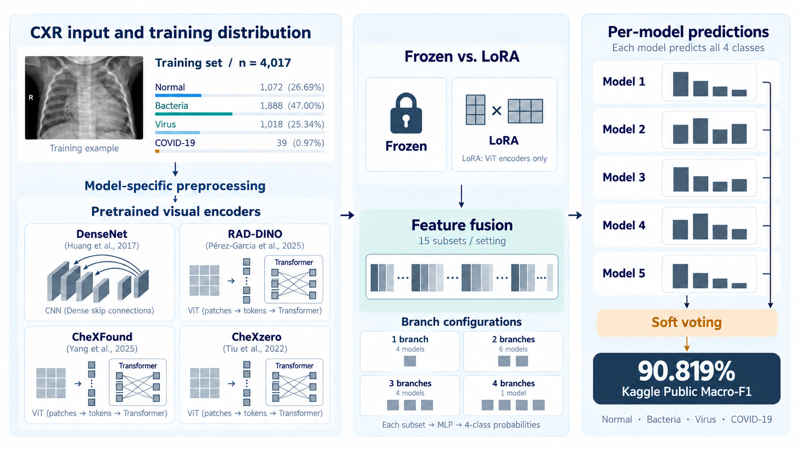
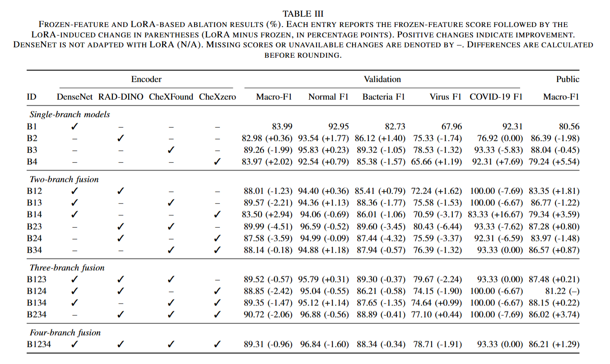

# AIMI LAB3: Multi-Branch Chest X-ray Classification

Code for the NYCU AIMI 2026 LAB3 four-class chest X-ray competition:
**Normal / Bacterial pneumonia / Viral pneumonia / COVID-19**.

The project compares CXR-pretrained encoders, all 15 nonempty branch subsets,
LoRA adaptation, imbalance-handling strategies, alternative fusion heads, and
probability-level soft voting. The best observed five-model ensemble achieved
**0.90819 Kaggle Public macro-F1 (90.819%)**. Public leaderboard feedback was used
in manual ensemble exploration; this is not an independent generalization estimate.

**Dataset images, pretrained weights, derived feature caches, and trained model
checkpoints are not included. Download third-party models from their original
sources below and obtain the competition dataset separately.**

For the full report, see [LAB3_412551030_黃羿寧.pdf](./LAB3_412551030_黃羿寧.pdf).


*Encoder icons, the radiograph, and probability bars are illustrative. Each model predicts all four classes.*

### Frozen-feature and LoRA results


Scores are reported in percent. Each entry shows the frozen-feature score,
followed by the LoRA-induced change in parentheses (percentage points).
Validation and Kaggle Public macro-F1 are reported separately.

### Soft-voting ensemble results



Ensembles are ranked by Kaggle Public macro-F1.
Scores are reported in percent; weights follow the listed model order.
The best five-model ensemble achieves 90.819% Public macro-F1
(90.82% after rounding).

## 1. Models and naming

| Branch | Encoder used | Feature output | Input during extraction |
|---|---|---|---|
| 1 | TorchXRayVision DenseNet-121 | Global average pooling, 1,024 dims | 224 × 224, grayscale |
| 2 | RAD-DINO, ViT-B/14 | CLS token, 768 dims | 224 × 224 |
| 3 | CheXFound, ViT-L/16 | Final CLS token, 1,024 dims | 512 × 512 |
| 4 | CheXzero visual encoder, ViT-B/32 | Image embedding, 512 dims | 224 × 224 |

Report labels **B1, B23, B134, B1234** identify the selected branches. These
are the same configurations; F1-score always refers to the evaluation metric.

In the frozen-feature setting, DenseNet is first fine-tuned on LAB3 training
images; RAD-DINO, CheXFound and CheXzero retain their CXR-pretrained encoder
weights. All encoders are fixed during cache extraction and fusion-head training.
In the LoRA setting, branches 2–4 are adapted and branch 1 reuses its DenseNet
cache. Single-branch LoRA results in this project are newly trained cached-feature
MLP classifiers, not the temporary linear heads used to train the adapters.

## 2. Repository contents

| File | Purpose |
|---|---|
| `lab3_common.py`, `train_lab3.py`, `predict_lab3.py` | Initial DenseNet/RAD-DINO baselines |
| `fourbranch.py` | Frozen feature extraction, concat/gated head training, prediction, voting |
| `fusion_heads.py` | Concat, projected concat, static/dynamic weighting, gated concat |
| `fourbranch_lora.py` | LoRA training and extraction |
| `lora_models.py`, `lora_layers.py`, `lora_validation.py` | Encoder loaders, adapters, dataset/cache checks |
| `run_branch_combinations.py` | Run all 15 concat configurations from a prepared cache |
| `gated_attention_experiment.py` | Branch self-attention plus gated pooling; six-head comparison |
| `run_imbalance_ablation.py` | Paired oversampling / weighted CE comparison over 15 subsets |
| `ensemble_search_lab3.py` | Optional bounded validation-based ensemble exploration |
| `evaluate_ensemble_validation.py` | Evaluate the 11 ensembles listed in the report |
| `test_*.py` | Synthetic checks for the new attention and search tools |

The original monolithic `run.sh` is deliberately not the main entry point in this
release. The commands below distinguish encoder preparation, cache extraction,
head training, and test submission generation explicitly.

## 3. Environment

Use Python **3.10 or newer**. The LoRA loader uses APIs such as memory-mapped
checkpoint loading; use a recent CUDA-enabled PyTorch with matching torchvision.
Install a GPU-compatible pair using the [official PyTorch selector](https://pytorch.org/get-started/locally/)
before installing project packages. Do not replace a working CUDA installation
with an unrelated upstream environment file.

Example setup (Windows CMD):

```cmd
conda create -n aimi_lab3 python=3.11 -y
conda activate aimi_lab3
```

After installing PyTorch/torchvision for your driver/GPU:

```cmd
python -m pip install -r requirements.txt
python -c "import torch; print(torch.__version__); print(torch.cuda.is_available()); print(torch.cuda.get_device_name(0) if torch.cuda.is_available() else 'CPU')"
```

Full image extraction and LoRA training require a suitable GPU; the LoRA runner
requires CUDA/BF16. Cached-feature head training is much cheaper. The alternative
fusion experiments were run on an RTX 4090; memory use depends on the encoder,
input resolution and physical batch size. Keep `--workers 0` on Windows.

Requirements are compatibility ranges, not a fully pinned lockfile. A fresh
installation across all external upstream revisions has not been end-to-end
validated. Preserve the environment and upstream commits used for a run.
`tested_environment.json` records installed package versions from the environment
used for the release smoke tests; it is informational, not an installation lockfile.

## 4. Dataset

```text
data/
  train_data.csv
  val_data.csv
  test_data_sample.csv
  train_images/
  val_images/
  test_images/
```

Expected CSV columns, in order:

```text
new_filename,normal,bacteria,virus,COVID-19
```

Training/validation labels are one-hot. The test CSV is a submission template,
not test ground truth. There are 4,017 training, 709 validation and 1,182 test
images. The training class counts are 1,072 / 1,888 / 1,018 / 39. The validation
set contains only seven COVID-19 images.

## 5. Download external code and pretrained weights

### 5.1 Third-party code

From the project root:

```cmd
git clone https://github.com/RPIDIAL/CheXFound.git external/CheXFound
git clone https://github.com/rajpurkarlab/CheXzero.git external/CheXzero
```

Follow each project's license and access conditions. Do not upload these cloned
repositories into this repository; `external/` is ignored. Record the commit IDs
using `git -C external/CheXFound rev-parse HEAD` and the equivalent CheXzero command.
Project-specific checkpoints and features should come from the same code/configuration.

### 5.2 Weight sources and required files

| Model | Original source | What to obtain |
|---|---|---|
| DenseNet | [TorchXRayVision](https://github.com/mlmed/torchxrayvision), [model card](https://huggingface.co/torchxrayvision/densenet121-res224-all) | `densenet121-res224-all`; downloaded by the library on first use |
| RAD-DINO | [Microsoft model card](https://huggingface.co/microsoft/rad-dino) | Hugging Face model + processor; downloaded automatically |
| CheXFound | [Official repository download instructions](https://github.com/RPIDIAL/CheXFound#guide-to-chexfound-with-glori), [linked checkpoint folder](https://drive.google.com/drive/folders/1GX2BWbujuVABtVpSZ4PTBykGULzrw806?usp=sharing) | Matching `config.yaml` and backbone `teacher_checkpoint.pth` |
| CheXzero | [Official repository](https://github.com/rajpurkarlab/CheXzero#model-checkpoints), [linked checkpoint folder](https://drive.google.com/drive/folders/1makFLiEMbSleYltaRxw81aBhEDMpVwno?usp=sharing) | `best_64_5e-05_original_22000_0.864.pt` |

Download manually from these original sources; access or availability may change.
This repository does not rehost the weights. CheXFound GLoRI weights are not
needed: the project extracts backbone CLS features and trains its own heads.
For CheXzero, use the named checkpoint rather than silently substituting another
member of the official checkpoint ensemble.

Place files as follows:

```text
pretrain_weight/
  chexfound/
    config.yaml
    teacher_checkpoint.pth
  chexzero/
    best_64_5e-05_original_22000_0.864.pt
```

The CheXFound configuration must match the downloaded ViT-L/16 checkpoint.
The loader expects a checkpoint containing a `teacher` backbone. The CheXzero
loader infers the visual architecture from tensor shapes and loads strictly;
the reported checkpoint is a 12-layer ViT-B/32 with a 512-d output.
`pretrained_files_manifest.json` records SHA-256 fingerprints and sizes of the
local pretrained files used by this project. This file contains no model tensors.
It can be used to compare your downloads, although upstream files may be revised.


### 5.3 CheXFound compatibility

The upstream project documents a Linux-oriented environment. The LoRA loader
disables xFormers and uses project attention compatibility helpers. The legacy
frozen extractor may still require optional upstream packages on some installations.
Use upstream guidance when an import is missing; do not blindly install an old
CUDA/xFormers build incompatible with your GPU. Run a small extraction first.
This release removes an unused evaluation-setup import and makes the frozen
CheXFound loader respect `--chexfound-config` and `--chexfound-weights`.

## 6. Prepare the frozen-feature encoders

Run from the repository root. These paths are also the defaults expected by
the historical extractor:

```cmd
python train_lab3.py --model xrv_densenet --data data --output outputs/xrv_oversampling --finetune-encoder --sampler balanced --loss ce --batch-size 8 --epochs 60 --patience 12 --lr 0.001 --backbone-lr 0.00001 --weight-decay 0.0001 --seed 42
python train_lab3.py --model rad_dino --data data --output outputs/raddino_oversampling --freeze-encoder --sampler balanced --loss ce --batch-size 8 --epochs 60 --patience 12 --seed 42
```

The second command is a compatibility preparation step: the frozen extractor
loads this local RAD-DINO checkpoint, but only uses its encoder. Because that
encoder is frozen, training this temporary head does not adapt its representation.
CheXFound and CheXzero are loaded directly from their downloaded checkpoints.

Existing legacy training directories may be overwritten by the original scripts.
For a new experiment, use a new output directory and pass the corresponding
`--xrv-checkpoint` / `--rad-checkpoint` paths to extraction.

## 7. Extract frozen features

```cmd
python fourbranch.py extract --branch densenet --data data --cache cache_embeddings --batch-size 64 --workers 0 --train-views 1
python fourbranch.py extract --branch raddino --data data --cache cache_embeddings --batch-size 32 --workers 0 --train-views 1
python fourbranch.py extract --branch chexfound --data data --cache cache_embeddings --batch-size 2 --workers 0 --train-views 1
python fourbranch.py extract --branch chexzero --data data --cache cache_embeddings --batch-size 32 --workers 0 --train-views 1
```

Reduce physical batch size if memory is insufficient. Extraction writes
`cache_embeddings/<branch>/{train,val,test}.npz`. Each file contains `x` features,
`names` and `y` labels (empty labels for test). The extractor preserves CSV order;
head training checks cross-branch order and label equality before concatenation.

Main experiments use one deterministic view per image. DenseNet uses grayscale
intensities in [-1024,1024]; RAD-DINO uses its processor normalization; CheXFound
uses its official evaluation transform; CheXzero uses CLIP normalization.
Frozen extraction uses 224-pixel inputs except CheXFound at 512 pixels.
Initial DenseNet training uses shorter-side resize plus center crop, while its
cached-feature extraction directly resizes to a square.

Use a new cache path for changed weights/preprocessing. The legacy extractor
can replace NPZ files at existing paths. Multiple `--train-views` are not the
reported experiment and should not be enabled casually: augmentations are not
synchronized across encoders and CheXFound remains deterministic.

## 8. Train all 15 frozen-feature configurations

Preview commands without training:

```cmd
python run_branch_combinations.py --cache cache_embeddings --setting frozen --plan
```

Train and generate test predictions:

```cmd
python run_branch_combinations.py --cache cache_embeddings --setting frozen --out outputs
```

The helper refuses existing per-model/prediction paths. Defaults match the main
experiment: concat head, hidden size 256, dropout 0.35, AdamW, learning rate 0.001,
weight decay 0.0001, batch 64, maximum 80 epochs, patience 15, seed 42,
`--sampler balanced --loss ce`. Here `balanced` means per-sample weight
`1/sqrt(class_count)`, not equal class proportions. Encoders are not trained.

Outputs include `outputs/f134/best.pt`, `best_val_report.json`,
`val_probabilities.csv`, `history.csv`, curves, confusion matrices, and
`outputs/submission_f134.csv` plus `outputs/submission_f134_probabilities.csv`.

For one configuration:

```cmd
python fourbranch.py train --branches densenet chexfound chexzero --cache cache_embeddings --data data --output outputs/f134 --sampler balanced --loss ce --batch-size 64 --seed 42
python fourbranch.py predict --checkpoint outputs/f134/best.pt --cache cache_embeddings --data data --split test --output outputs/submission_f134.csv
```

## 9. LoRA training and extraction

Adapters target query/value projections in the last four Transformer blocks:
rank 8, alpha 16, adapter learning rate 0.0001, head learning rate 0.001,
maximum 20 epochs and patience 5. Base weights remain frozen. The temporary
head uses LayerNorm, dropout 0.25 and a four-class linear layer.

```cmd
python fourbranch_lora.py train --branch raddino --data data --output outputs/lora_s42/raddino --batch-size 4 --accum-steps 4 --rank 8 --alpha 16 --last-blocks 4 --epochs 20 --patience 5 --seed 42
python fourbranch_lora.py train --branch chexfound --data data --output outputs/lora_s42/chexfound --batch-size 1 --accum-steps 16 --rank 8 --alpha 16 --last-blocks 4 --epochs 20 --patience 5 --seed 42
python fourbranch_lora.py train --branch chexzero --data data --output outputs/lora_s42/chexzero --batch-size 4 --accum-steps 4 --rank 8 --alpha 16 --last-blocks 4 --epochs 20 --patience 5 --seed 42
```

Nominal effective batch size is 16. LoRA training applies rotation ±5 degrees
and brightness/contrast jitter 0.06 with probability 0.5. Validation and extraction
are deterministic. The runner writes audit/configuration information and refuses
nonempty training outputs. See `--help` for optional patient metadata auditing.
Filename consistency checks alone do not establish patient-level independence.

```cmd
python fourbranch_lora.py extract --branch raddino --data data --adapter outputs/lora_s42/raddino/best.pt --cache cache_embeddings_lora_s42
python fourbranch_lora.py extract --branch chexfound --data data --adapter outputs/lora_s42/chexfound/best.pt --cache cache_embeddings_lora_s42
python fourbranch_lora.py extract --branch chexzero --data data --adapter outputs/lora_s42/chexzero/best.pt --cache cache_embeddings_lora_s42
```

DenseNet does not use LoRA. Copy its unchanged features (Windows CMD):

```cmd
mkdir cache_embeddings_lora_s42\densenet
copy cache_embeddings\densenet\*.npz cache_embeddings_lora_s42\densenet\
python run_branch_combinations.py --cache cache_embeddings_lora_s42 --setting lora --out outputs
```

This produces names such as `f3_lora_s42` and `f134_lora_s42` and root-level test
probability files. The DenseNet-only result is an unchanged reference.

## 10. Fusion-head and class-imbalance ablations

Same B1234 cache, six fusion heads:

```cmd
python gated_attention_experiment.py --cache cache_embeddings --fusion all --out outputs/gated_frozen_s42 --predict-test
python gated_attention_experiment.py --cache cache_embeddings_lora_s42 --fusion all --out outputs/gated_lora_s42 --predict-test
```

The new gated-attention head performs four-head branch-token self-attention and
gated pooling. The existing `dynamic_gated` mode uses an MLP gate, not self-attention.
Pooling weights are diagnostics, not causal branch-importance estimates.
See [attention experiment details](README_GATED_ATTENTION_EXPERIMENT.md).

All 15 frozen subsets, two imbalance-handling strategies:

```cmd
python run_imbalance_ablation.py --cache cache_embeddings --plan
python run_imbalance_ablation.py --cache cache_embeddings --predict-test
```

This compares standard CE + square-root oversampling against weighted CE +
natural sampling (30 head runs). Weighted CE uses class weights proportional to
`sqrt(N/n_c)`, normalized to mean one. These are not applied together.
Both runners create unique output directories and `summary.csv` files. Numeric
scores in CSVs use [0,1]; multiply by 100 for percentages.

## 11. Best observed soft-voting ensemble

After generating all required test probability files:

```cmd
python fourbranch.py ensemble --prob-files outputs/submission_f3_probabilities.csv outputs/submission_f134_probabilities.csv outputs/submission_f3_lora_s42_probabilities.csv outputs/submission_f134_lora_s42_probabilities.csv outputs/submission_f23_probabilities.csv --weights 1 1 1 1 1 --data data --split test --output outputs/submission_best5.csv
```

The five normalized weights are 0.2 each. Upload `submission_best5.csv` to Kaggle,
not the `_probabilities.csv` file. Output columns are
`new_filename,normal,bacteria,virus,COVID-19`, with one predicted class per image
and the official test-template order.

This reproduces the ensemble rule, not a guaranteed leaderboard score: retraining,
upstream revisions, numerical behavior and checkpoint selection can change results.
The legacy ensemble command writes its requested destination; choose a new filename
when preserving previous predictions.

Evaluate the report's 11 ensembles on validation (no GPU needed):

```cmd
python evaluate_ensemble_validation.py --root outputs --data data
```

For a single custom validation ensemble, use the analogous command with validation
paths (`outputs/f3/val_probabilities.csv`, etc.) and `--split val`.

Optional validation-based bounded search:

```cmd
python ensemble_search_lab3.py --root outputs --data data --max-trials 200 --max-rounds 3 --max-models 8 --submit-top 3
```

This optional search is separate from the manually explored report ensembles.
Do not describe all reported manual trials as validation-only search results.


## 12. Checks and troubleshooting

```cmd
python test_ensemble_search_lab3.py
python test_gated_attention_experiment.py
```

The synthetic tests check alignment, validation scoring, bounded search, normalized
gates, gradients, checkpoint reload and submission generation. They do not replace
a clean-machine end-to-end run with the real external weights.

* **CUDA unavailable:** confirm that the terminal uses the intended environment and
  that PyTorch/torchvision match the installed driver and GPU.
* **Out of memory during extraction/adaptation:** reduce physical batch size;
  increase LoRA gradient accumulation to retain the desired effective batch size.
* **Missing local RAD/DenseNet checkpoint:** finish encoder preparation or pass
  explicit checkpoint paths to `fourbranch.py extract`.
* **CheXFound state-dict mismatch:** verify that the downloaded configuration and
  teacher checkpoint match; do not suppress incompatible loading errors.
* **Cache mismatch:** rebuild all affected splits from the same encoder checkpoint,
  preprocessing and CSVs. Do not mix arbitrary caches because dimensions match.
* **Custom gated-attention checkpoint:** original `fourbranch.py predict` does not
  know this new mode. Generate submissions through the wrapper's `--predict-test`.
* **Limited COVID validation:** seven positives make macro-F1 sensitive to small
  prediction changes. Keep Public evaluation distinct from local validation.

## 13. Attribution and third-party materials

This project implements LAB3 training/fusion experiments using third-party model
architectures, libraries and pretrained checkpoints. Ownership and applicable
licenses for those materials remain with their authors. Consult the original
repositories, model cards and dataset terms. No license for this project's own
code is assigned by this README; choose an appropriate repository license separately.

* Huang et al., **Densely Connected Convolutional Networks**, CVPR 2017.
* Cohen et al., **TorchXRayVision: A library of chest X-ray datasets and models**,
  [arXiv:2111.00595](https://arxiv.org/abs/2111.00595).
* Pérez-García et al., **Exploring scalable medical image encoders beyond text
  supervision**, Nature Machine Intelligence, 2025.
* Yang et al., **Chest X-ray Foundation Model with Global and Local Representations
  Integration**, [arXiv:2502.05142](https://arxiv.org/abs/2502.05142), 2025.
* Tiu et al., **Expert-level detection of pathologies from unannotated chest X-ray
  images via self-supervised learning**, Nature Biomedical Engineering, 2022.
* Hu et al., **LoRA: Low-Rank Adaptation of Large Language Models**, ICLR 2022.
* Kittler et al., **On Combining Classifiers**, IEEE TPAMI, 1998.
* Kang et al., **Decoupling Representation and Classifier for Long-Tailed
  Recognition**, ICLR 2020.

